# Projeto e Construção de um Robô Sumô

Guia de referência para montagem, programação e desenvolvimento de um robô Sumô autônomo da **classe 700 g**, baseado no material da UNINASSAU – Graças, versão 5, de 29/08/2026.

## Sumário

- [1. Introdução](#1-introdução)
- [2. Regras da competição](#2-regras-da-competição)
- [3. Funcionamento da partida](#3-funcionamento-da-partida)
- [4. Opções de montagem](#4-opções-de-montagem)
- [5. Microcontrolador](#5-microcontrolador)
- [6. Sensores de borda — TCRT5000](#6-sensores-de-borda--tcrt5000)
- [7. Motores TT e ponte H](#7-motores-tt-e-ponte-h)
- [8. Detecção do adversário](#8-detecção-do-adversário)
- [9. Alimentação](#9-alimentação)
- [10. Relação de materiais](#10-relação-de-materiais)
- [11. Estimativa de peso e custo](#11-estimativa-de-peso-e-custo)
- [12. Referências visuais](#12-referências-visuais)

## 1. Introdução

Este projeto apresenta os conceitos básicos para desenvolver e construir um robô Sumô autônomo. O documento reúne as regras da competição, os componentes eletrônicos e mecânicos, os sensores, o sistema de movimentação e as opções de alimentação.

O objetivo é orientar o projeto, a montagem, a programação e os testes de um robô capaz de localizar o adversário, avançar para empurrá-lo e evitar sair da arena (*dohyo*).

## 2. Regras da competição

As regras descritas são destinadas à classe **Sumô 700 g**.

| Item | Regra |
|---|---|
| Dimensões | Máximo de 20 × 20 cm |
| Altura | Livre |
| Peso | Máximo de 700 g, incluindo a bateria |
| Controle | Autônomo durante a luta |
| Acionamento | Permitido apenas para iniciar/parar |
| Locomoção | Livre, desde que não danifique o *dohyo* |
| Objetivo | Empurrar o adversário para fora do *dohyo* |
| Sensores | Livres |
| Microcontrolador | Livre |
| Alimentação | Bateria instalada no próprio robô |
| Fixação ao *dohyo* | Proibida |
| Sucção/aderência artificial | Proibida na classe 700 g |
| Armas/projéteis | Proibidos |
| Partes cortantes/perigosas | Proibidas |
| Danificar o adversário ou o *dohyo* | Proibido |

**Atenção:** não podem ser usados mecanismos destinados a aumentar artificialmente a aderência ou o peso efetivo sobre o *dohyo*. Também são proibidas partes afiadas ou capazes de danificar o adversário ou a arena.

## 3. Funcionamento da partida

1. Os dois robôs são posicionados no *dohyo*, conforme a orientação da organização.
2. O operador aciona o robô antes do início do combate.
3. Após o comando de início do árbitro, o robô deve permanecer **5 segundos sem se movimentar**.
4. Ao terminar esse período, começa a operação totalmente autônoma, sem intervenção do operador.
5. Durante o combate, o robô usa os sensores para localizar o adversário, atacar e evitar a borda do *dohyo*.

O fluxo básico apresentado no material é:

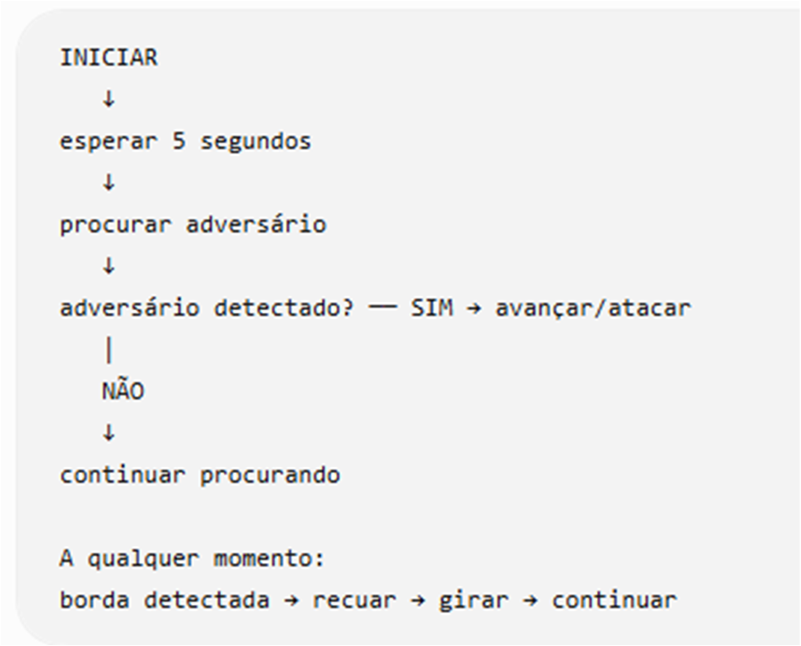

## 4. Opções de montagem

O material apresenta duas possibilidades:

### Opção 1 — Kit completo

Aquisição de um kit de robô Sumô, utilizando os componentes fornecidos pelo fabricante. O exemplo citado é o kit RS100 V2, normalmente baseado no **Arduino UNO R3** e que utiliza a ponte H L9110S.

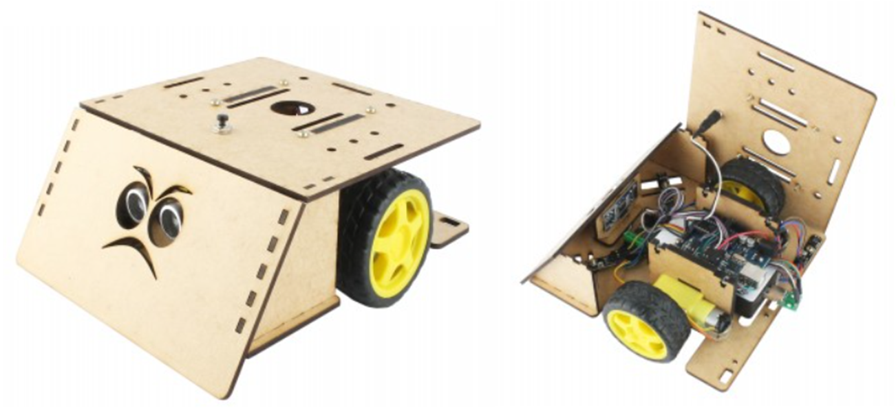

Manual citado no documento: [Robô Sumô Zumo Robot RS100 V2 — UsinaInfo](https://www.usinainfo.com.br/robotica-educacional/robo-sumo-zumo-robot-completo-rs100-v2-para-arduino-manual-de-montagem-6021.html).

### Opção 2 — Montagem por componentes

Compra individual dos componentes, permitindo utilizar **Arduino UNO R3** ou **ESP32-WROOM**, com a ponte H TB6612FNG como alternativa para controlar os motores.

As ligações e os cuidados de cada plataforma são apresentados nas seções seguintes.

## 5. Microcontrolador

O projeto admite duas placas:

- **Arduino UNO R3:** trabalha com lógica de 5 V.
- **ESP32-WROOM-32 DevKit:** trabalha com GPIO de 3,3 V.

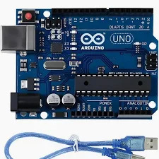

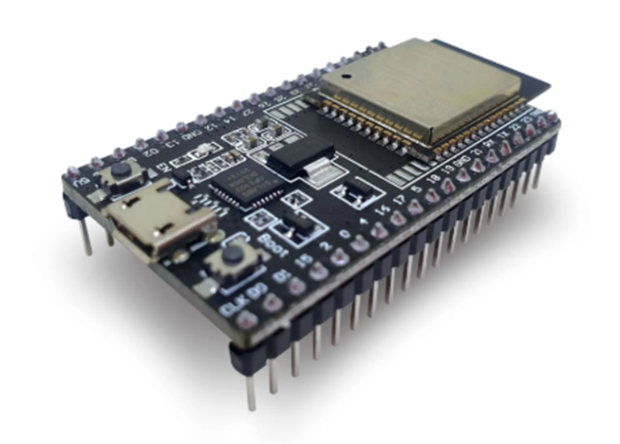

No caso do ESP32, o material apresenta a alimentação de 5 V na entrada VIN/5V da placa, passando pelo regulador interno para fornecer 3,3 V ao microcontrolador.

**Atenção:** as entradas GPIO do ESP32 operam em 3,3 V. Não aplique 5 V diretamente a essas entradas.

## 6. Sensores de borda — TCRT5000

O TCRT5000 é utilizado para detectar a borda do *dohyo*. O material recomenda **dois sensores**, instalados na parte inferior dianteira do robô: um à esquerda e outro à direita. Assim, o robô consegue identificar de qual lado detectou a borda e corrigir sua trajetória.

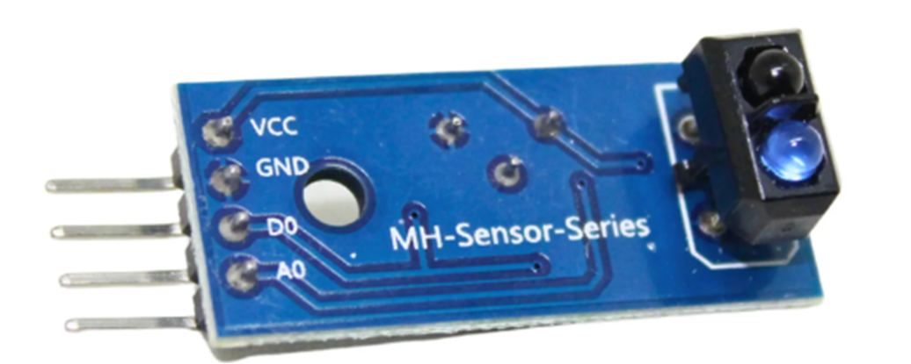

### Ligações

| TCRT5000 | Arduino UNO R3 | ESP32-WROOM |
|---|---|---|
| VCC | 5 V | 3,3 V |
| GND | GND | GND |
| DO | Pino digital | GPIO |
| AO | Opcional | Opcional |

O material indica que a saída digital (DO) pode ser usada para a detecção, enquanto a saída analógica (AO) é opcional.

## 7. Motores TT e ponte H

O robô utiliza **dois motores DC com caixa de redução**, responsáveis por movimentar as rodas de forma independente. O motor TT amarelo indicado é normalmente um motor DC de 3 a 6 V. A caixa de redução aumenta o torque e diminui a velocidade.

A roda TT indicada tem aproximadamente **40–45 mm de diâmetro** e **15–20 mm de largura**.

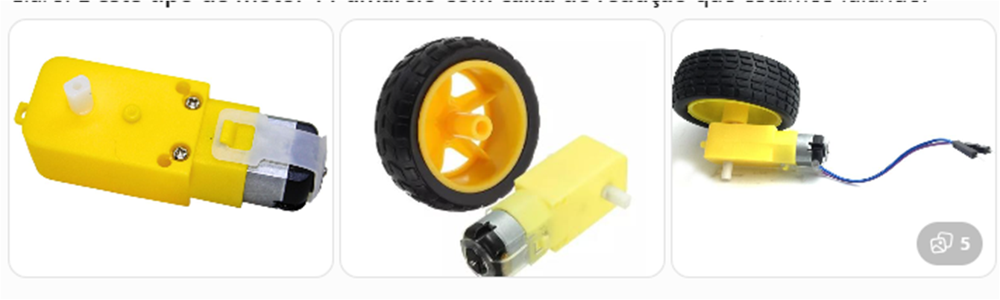

**Os motores não devem ser ligados diretamente ao Arduino UNO R3 ou ao ESP32.** É necessária uma ponte H para fornecer a corrente aos motores e controlar o sentido de rotação.

### Opções de ponte H

| Característica | L9110S | TB6612FNG |
|---|---|---|
| Motores controlados | 2 | 2 |
| Compatível com Arduino UNO R3 | Sim | Sim |
| Compatível com ESP32-WROOM | Sim | Sim |
| Controle de direção | Sim | Sim |
| Controle por PWM | Sim | Sim |
| Utilização indicada | Kit RS100 V2 | Montagem alternativa |

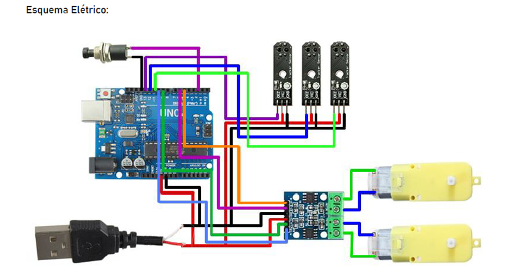

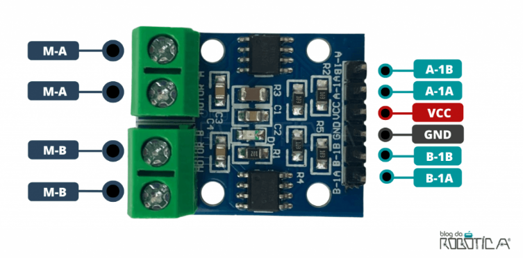

### Ligações da TB6612FNG

| Pino da TB6612FNG | Arduino UNO R3 | ESP32-WROOM | Função |
|---|---|---|---|
| VCC | 5 V | 3,3 V | Alimentação lógica |
| GND | GND | GND | Terra comum |
| VM | Alimentação dos motores | Alimentação dos motores | Potência dos motores |
| AIN1 / AIN2 | Pinos digitais | GPIO | Direção do motor A |
| BIN1 / BIN2 | Pinos digitais | GPIO | Direção do motor B |
| PWMA | Pino PWM | GPIO/PWM | Velocidade do motor A |
| PWMB | Pino PWM | GPIO/PWM | Velocidade do motor B |
| STBY | 5 V ou pino digital | 3,3 V ou GPIO | Habilitação |
| AO1 / AO2 | Motor A | Motor A | Saída do motor A |
| BO1 / BO2 | Motor B | Motor B | Saída do motor B |

A TB6612FNG pode ser usada com Arduino UNO R3 (lógica de 5 V) ou ESP32-WROOM (lógica de 3,3 V).

## 8. Detecção do adversário

O documento apresenta duas alternativas para localizar o robô adversário:

- **HC-SR04:** sensor ultrassônico que mede a distância usando ondas sonoras.
- **VL53L0X:** sensor de distância a laser.

### HC-SR04

O material recomenda instalar um HC-SR04 na parte frontal, apontado para a frente, para informar ao microcontrolador a distância aproximada do adversário.

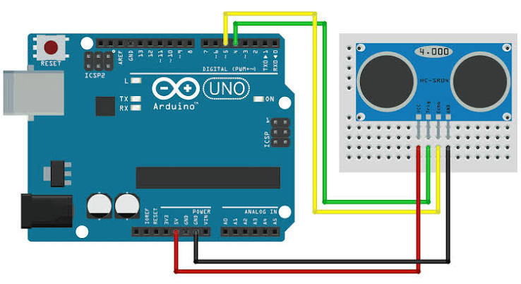

| HC-SR04 | Arduino UNO R3 | ESP32-WROOM |
|---|---|---|
| VCC | 5 V | 5 V |
| GND | GND | GND |
| TRIG | Pino digital | GPIO |
| ECHO | Pino digital | GPIO via divisor resistivo |

**Atenção ao pino ECHO:** no Arduino UNO R3, o sinal de aproximadamente 5 V é compatível com as entradas digitais. No ESP32, o sinal deve ser reduzido para aproximadamente 3,3 V por meio de um divisor resistivo.

O divisor sugerido no material utiliza:

```text
ECHO → resistor de 1 kΩ → GPIO 19 → resistor de 2 kΩ → GND
```

Essa configuração reduz aproximadamente 5 V para 3,3 V.

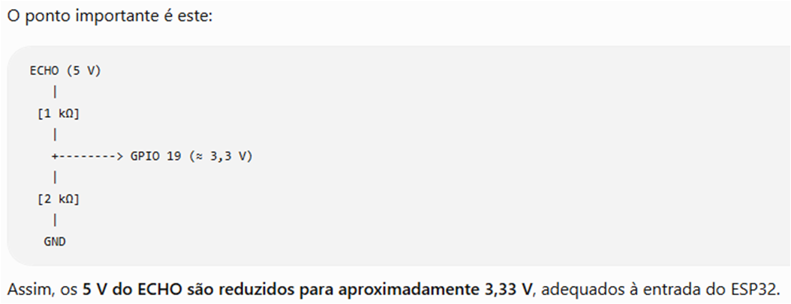

### VL53L0X

O VL53L0X é apresentado como alternativa de sensor a laser. Segundo o documento, ele utiliza um feixe de luz para calcular a distância até o alvo. O material destaca a velocidade e a precisão da detecção em comparação com sensores ultrassônicos tradicionais.

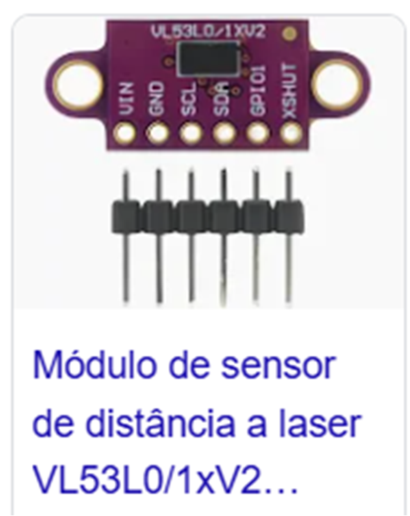

**Observação do material:** o módulo baseado no TCRT5000 tem alcance muito pequeno, tipicamente de poucos centímetros, e não é uma boa escolha para detectar o adversário. No projeto, o TCRT5000 é destinado à detecção da borda, não à localização do oponente.

## 9. Alimentação

A alimentação depende da opção de montagem escolhida.

### Opção 1 — Kit RS100 V2

O kit utiliza:

- Duas baterias 18650 Li-Ion de 3,7 V.
- Módulo de alimentação e carregamento fornecido no próprio kit.

Essa configuração pode ser mantida por quem utilizar a montagem completa do fabricante.

### Opção 2 — Montagem por componentes

O documento sugere uma bateria **LiPo 2S de 7,4 V**, com capacidade aproximada de **1000 a 1500 mAh** e taxa de descarga de **20C ou superior**.

A distribuição indicada é:

```text
LiPo 7,4 V ──→ VM da TB6612FNG ──→ Motores

LiPo 7,4 V ──→ Conversor Buck ajustado para 5 V ──→ Arduino UNO ou ESP32
```

O **GND deve ser comum** entre o microcontrolador, a ponte H e a alimentação.

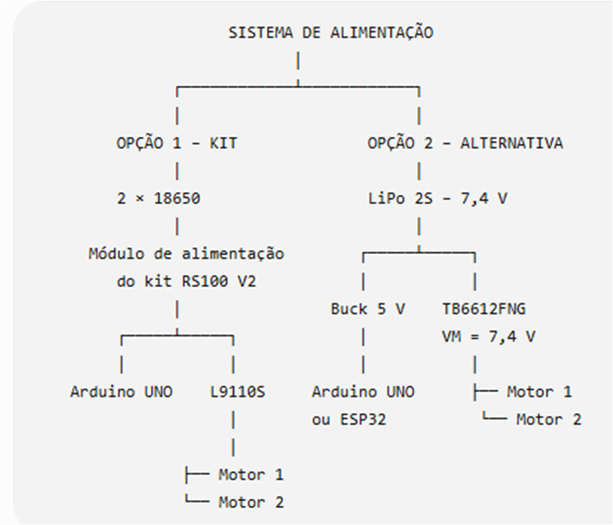

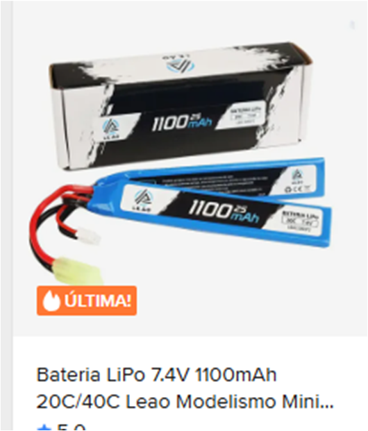

### Conversor Buck

Para a alternativa com bateria LiPo 2S, o material cita o conversor LM2596, ajustado para 5 V.

| Característica | Especificação apresentada |
|---|---|
| Entrada | 7,4 V da LiPo 2S |
| Saída | 5 V regulados |
| Corrente de saída | 2 A |
| Tipo | Step-down (Buck) |
| Uso | Alimentação do ESP32 e sensores |

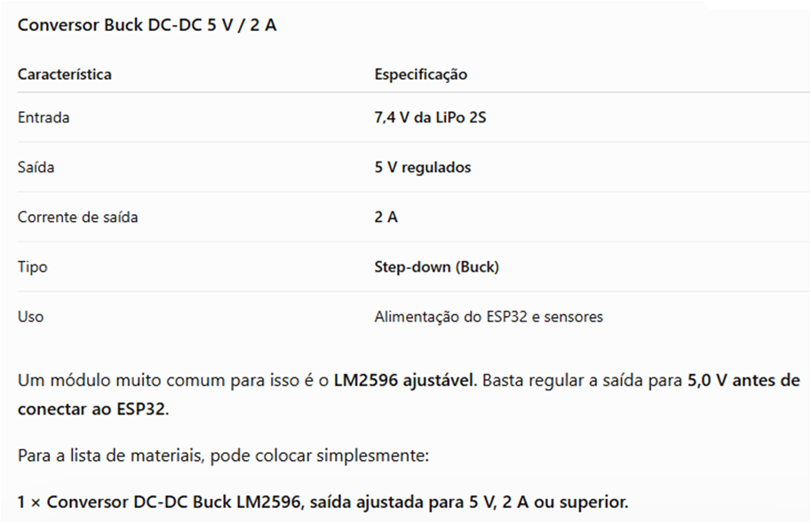

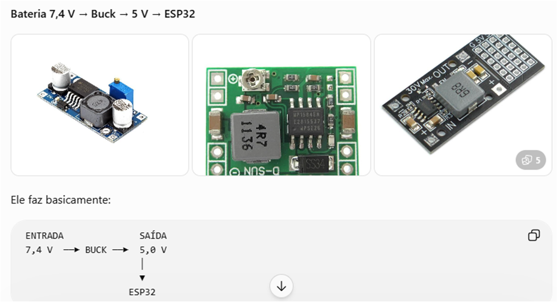

**Importante:** antes de conectar a placa, ajuste e confira a saída do conversor para 5 V, conforme indicado no material.

## 10. Relação de materiais

### Componentes principais

| Qtd. | Componente | Especificação |
|---:|---|---|
| 1 | Microcontrolador | Arduino UNO R3 (kit) ou ESP32-WROOM |
| 1 | Ponte H | L9110S (kit) ou TB6612FNG |
| 2 | Motor TT | Motor DC com caixa de redução |
| 2 | Rodas | Compatíveis com o eixo do motor TT |
| 2 | Sensor de borda | TCRT5000 |
| 1 | Sensor do adversário | HC-SR04 ou VL53L0X |
| 1 | Sistema de alimentação | Kit: 2 × 18650 + módulo próprio; alternativa: LiPo 2S 7,4 V |
| 1 | Conversor Buck | LM2596, ajustado para 5 V — quando utilizada LiPo 2S |
| 1 | Botão de acionamento | Push button para início do robô |
| 1 | Conector para bateria | Compatível com a bateria utilizada |
| 1 | Carregador | Compatível com o sistema de bateria utilizado |

### Estrutura e materiais auxiliares

| Qtd. | Componente | Especificação |
|---:|---|---|
| 1 | Chassi | Máximo de 20 × 20 cm |
| 1 | Mini protoboard | 170 pontos |
| 1 | Cabo USB | Compatível com Arduino UNO ou ESP32 |
| — | Jumpers/fios | Para interligações |
| — | Parafusos e espaçadores | Para montagem |

## 11. Estimativa de peso e custo

De acordo com o documento:

- **Peso estimado máximo:** 560 g para o kit RS100 V2.
- **Limite da categoria:** 700 g, incluindo a bateria.
- **Investimento estimado:** R$ 410,00.

O custo pode variar conforme o sensor de detecção do adversário e o fornecedor escolhido para cada peça, nacional ou importado.

Esses valores são estimativas do material de referência, não cotações atualizadas.

## 12. Referências visuais

As imagens extraídas do PDF foram preservadas na pasta `assets/` e nomeadas em sequência, seguindo a ordem em que aparecem no documento original:

| Arquivo | Página do PDF | Conteúdo |
|---|---:|---|
| `imagem1.png` | 3 | Exemplo de robô Sumô |
| `imagem2.png` | 3 | Fluxo básico de funcionamento |
| `imagem3.png` | 4 | Sensor TCRT5000 |
| `imagem4.png` | 4 | ESP32-WROOM-32 DevKit |
| `imagem5.png` | 4 | Arduino UNO R3 |
| `imagem6.png` | 5 | Motores TT e rodas |
| `imagem7.png` | 6 | Esquema elétrico ilustrativo |
| `imagem8.png` | 7 | Ponte H L9110S |
| `imagem9.png` | 8 | Ligação do HC-SR04 |
| `imagem10.png` | 9 | Sensor a laser VL53L0X |
| `imagem11.png` | 9 | Divisor resistivo para o ECHO |
| `imagem12.png` | 10 | Diagrama das opções de alimentação |
| `imagem13.png` | 10 | Exemplo de bateria LiPo |
| `imagem14.png` | 11 | Informações do conversor Buck |
| `imagem15.png` | 11 | Módulos e ligação do conversor Buck |

---

**Documento-base:** *Projeto e Construção de um Robô Sumô — Guia básico para montagem, programação e desenvolvimento*, UNINASSAU – Graças, professores Bernardo, David e Rafael, versão 5, 29/08/2026.

Este README organiza o conteúdo do PDF. Ele não substitui as regras oficiais da competição nem um diagrama elétrico específico da montagem final da equipe.
